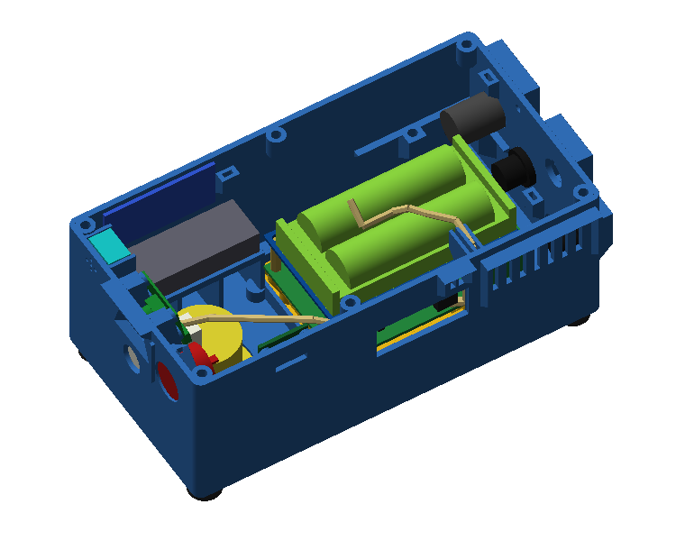
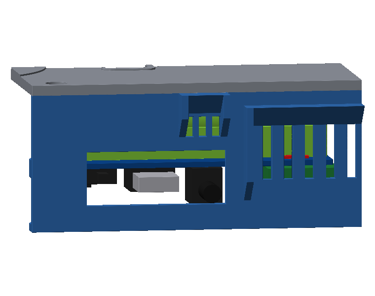
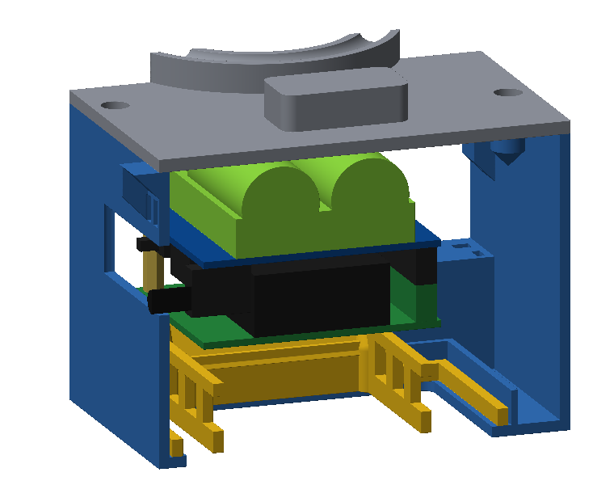
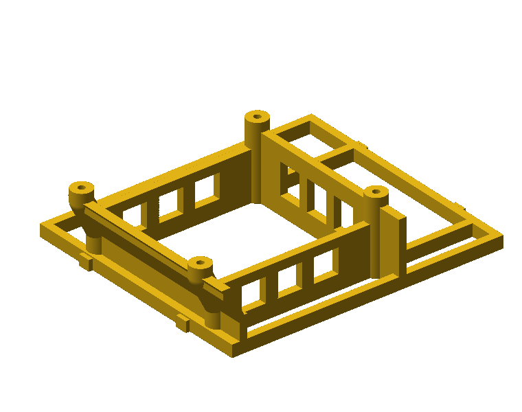
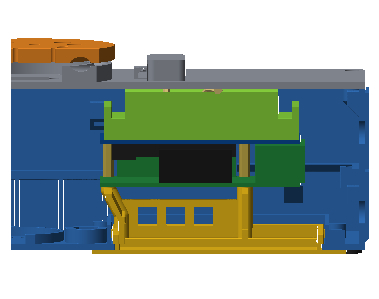

# MoveEye Gehäuse 5.3.1 – Nachtrag zu v5.3

Stand 08.11.2026. **5.3.1 ändert kein Teil von v5.3.** Neu ist nur ein zusätzliches Druckteil, der
**Adapter 28** für das alte Waveshare «UPS HAT», dazu diese Anleitung. Alles andere gilt wie in
[LIESMICH_Montage_v5-3.md](LIESMICH_Montage_v5-3.md).
Quelle: `Quellcode/upsalt531.py`. Die Datei importiert `v53.py`, `v52.py` und `v5.py` und ändert sie nicht.

| Neu | Datei |
|---|---|
| 28 Adapter altes UPS HAT (provisorisch) | [Druckdateien/v5-3/MoveEye_v5-3_28_Adapter_UPS_HAT_alt.3mf](../Druckdateien/v5-3/MoveEye_v5-3_28_Adapter_UPS_HAT_alt.3mf) |

## Provisorisch: alter UPS HAT

Für die Zeit, bis das UPS HAT (E) da ist: das ältere **Waveshare «UPS HAT»** (SKU 18306, «UPS HAT (EU)», später auch als UPS HAT (A)
verkauft) mit **2 × 18650** in Serie im unveränderten Gehäuse v5.3. **Nur drinnen oder auf dem Tisch.**

### Was läuft, was nicht

- Am alten HAT hängen **nur der Pi 5 und die Kameras**. Er gibt den Strom über die GPIO-Leiste (5 V, laut Waveshare bis 2,5 A).
- **Servos, Licht und Lautsprecher** laufen nicht über dieses HAT. Sie bleiben aus oder bekommen eine eigene Versorgung.
  Die Verdrahtung von v5 (B+ / B− des UPS HAT (E) → Sicherung → Step-down) **gilt hier nicht**.
- **Geladen wird direkt am HAT:** das mitgelieferte **Ladegerät 8,4 V / 2 A** in die Hohlbuchse des HAT. Die Buchse liegt hinter dem
  Service-Fenster, Stopfen 10 ist dafür draussen.
- **Die GX16-Ladebuchse und der Pololu-Lader (5-V-Pfad) werden nicht an dieses HAT angeschlossen.**

### Aufbau (von unten nach oben)

1. **Adapter 28** im Akku-Zaun, an der Stelle von UPS HAT (E) und Zellen, wie der Entwicklungs-Sockel 13. Die Klemmrippen drücken
   gegen den Zaun. Die Akkuklappe 26 bleibt zu.
2. **Pi 5 mit Active Cooler** auf den 4 Bolzen des Adapters. Seine Unterseite liegt auf z 26,65, in v5.3 auf z 39,5. Gegenüber v5.3
   sitzt er 6 mm weiter zur Stirnseite (x 68–153) und 5 mm weiter innen (y 8–64).
3. **4 Abstandsbolzen M2,5 × 17** und eine **GPIO-Verlängerung 2 × 20** halten das HAT 17 mm über dem Pi. Darunter hat der Active
   Cooler Platz: Raspberry Pi und Pimoroni nennen 15–17 mm Abstand für HATs über dem Active Cooler. Die Buchsenleiste des HAT muss mit
   der Verlängerung noch sicher auf den Stiften sitzen.
4. **UPS HAT**, Bauteile nach unten: 8,4-V-Buchse, USB-A, Schalter und Spule. Die Seite mit den Buchsen zeigt zur Lüftungswand (−y),
   der Batteriehalter mit den **2 × 18650 oben**.

So liegen die Anschlüsse hinter den Öffnungen, die es schon gibt:

| Was | Wo | Geprüft am Modell |
|---|---|---|
| 8,4-V-Buchse (Laden) | Service-Fenster, x 115,3 / Achse z 38,75, steht 2,8 mm über die Platine vor | Hülse Ø 5,5 geht durch: 0,35 mm Luft nach unten, 1,65 mm zum Fensterrand |
| USB-A (5 V OUT) | Service-Fenster, x 99,5 | Stecker geht durch, 0,55 mm Luft |
| Schalter ON/OFF | Service-Fenster, x 84,2; der Schieber steht 4,5 mm vor, ca. 6 mm hinter der Wandaussenseite | mit einem Stift Ø 3 erreichbar |
| WARNING-LEDs (Verpolung) | hinter den Lüftungsschlitzen, x 137,5–146,5 | gerade Sicht durch 2 Schlitze |

### Was dafür draussen bleibt (die Teile selbst sind unverändert)

- **Stopfen 10** (Service-Fenster), solange das HAT drin ist: Laden, USB-A und Schalter gehen durch dieses Fenster.
- **Luftkanal 27**: Er hätte keinen Platz zwischen Kühler und HAT, und die Haube stösst an den Batteriehalter.
- **Zwischenboden 09** mit Pololu-Lader, PAM-Verstärker und INA219 (Solar): Der Pi liegt tiefer und weiter innen. USB/Ethernet
  und HAT stossen an Boden und Lader (rund 1–1,5 mm), und gebraucht wird der Zwischenboden hier nicht.
- **UPS HAT (E)** mit 4 × 21700 und der Entwicklungs-Sockel 13.

### Kamerakabel

Die Buchsen CAM/DISP 0 und 1 des Pi 5 liegen jetzt **unter dem HAT**, wahrscheinlich direkt unter der 8,4-V-Buchse. Vorschlag aus
dem Modell (gelb im Bild oben):

- Jedes Flachkabel direkt an der Buchse flach zur Lüftungswand legen, unter den Bauteilen des HAT (rund 1 mm Luft).
- An der Wand hochführen, im Kabelkamm: CAM1 in Schlitz 1, CAM0 in Schlitz 2.
- **CAM0 (Kopf):** über die vordere Zelle, dann in der Mulde zwischen den Zellen zum Kabelkamin. Zwischen Zelle und Deckel bleiben
  nur **ca. 1,2 mm**. Das Kabel braucht im Modell **ca. 115 mm statt 75 mm** wie in v5.3, also vielleicht ein längeres Kabel.
- **CAM1 (Weitwinkel):** flach an der Lüftungswand unter dem Deckel-Dom und über dem PCA9685. Länge etwa wie v5.3 (160 mm).

### Druck

| Teil | Lage | Material | Schicht | Wände | Füllung | Stützen | Brim | Zeit / Gewicht |
|---|---|---|---|---|---|---|---|---|
| 28 Adapter altes UPS HAT | Rahmen unten, Bolzen oben (wie eingebaut) | PETG | 0,20 mm | 3 | 15 % | keine | keiner | ca. 1,5–2 h, ca. 15–18 g |

Masse 95,9 × 79,2 × 24,2 mm. Die zwei Bolzen auf der Stirnseite stehen schräg: unten im Zaun, über der Zaunkante um ca. 27°
nach aussen geneigt, damit sie unter die Löcher des Pi kommen. Das geht ohne Stützen. Prüfen im Ordner `Quellcode/`:
`python3 check531.py` (Kollisionen, Höhe, Zugang, LEDs, Kabel), `python3 printcheck531.py` (Überhänge, Inseln),
`python3 druckcheck531.py` (Wandstärken), Bilder `python3 prev531.py` (nach `out531/`, Kopien in `Bilder/Vorschau_v5-3-1_*.png`). Neu erzeugen: `python3 export531.py` (STL nach
`out531/`, 3MF nach `Druckdateien/v5-3/`).

### Schrauben und Teile

| Menge | Was | Wofür |
|---|---|---|
| 4 | Abstandsbolzen M2,5 × 17 mm, Innen-/Aussengewinde (Aussengewinde ≥ 5 mm) | durch die Pi-Löcher in die Bolzen des Adapters (Kernloch Ø 2,2, 8 mm tief, schneidet sich ein); tragen das HAT |
| 4 | Schraube M2,5 × 6 | oben durch das HAT (Loch Ø 3,0) in die Abstandsbolzen |
| 1 | GPIO-Verlängerung 2 × 20 (Stapelleiste / «Booster Header») | Pi-Stifte → Buchsenleiste des HAT bei 17 mm Abstand |

Wer nur Bolzen mit Innengewinde an beiden Enden hat, nimmt unten je einen Gewindestift M2,5 × 10.

### Warnungen

- **2S Li-Ion (bis 8,4 V).** Nur mit dem **Ladegerät 8,4 V / 2 A** von Waveshare an der Hohlbuchse des HAT laden. Waveshare warnt,
  dass andere Netzteile das Modul zerstören können.
- **Nie den GX16-/Pololu-/5-V-Pfad von MoveEye an dieses HAT anschliessen.** Auch nicht gleichzeitig ein USB-C-Netzteil am Pi:
  Der Pi bekommt seinen Strom über die GPIO-Leiste vom HAT.
- **Nur drinnen**, auf einer nicht brennbaren Unterlage, nicht unbeaufsichtigt laden. Mit offenem Service-Fenster ist das Gehäuse
  nicht dicht.
- Zellen 18650 **ohne Schutzplatine**, Länge unter 67 mm (Angabe Waveshare), beide gleich (Typ, Ladezustand). Nach dem Einsetzen
  die **WARNING-LEDs** prüfen: Leuchtet eine, ist eine Zelle verkehrt herum. Dann nicht laden.
- **Wärme:** Über dem Lüfter des Active Cooler bleiben nur **ca. 2,6 mm** bis zum HAT, und Luftkanal 27 fehlt. Die Temperatur mit
  `vcgencmd measure_temp` beobachten. Wird es zu heiss, den Deckel für Tests offen lassen.
- **Strom:** Das HAT gibt laut Waveshare 5 V mit bis zu 2,5 A. Für Pi 5 und Kameras sollte das reichen, nicht aber für viel
  USB-Last. Meldet der Pi Unterspannung, USB-Geräte abziehen.

### Software

Keine Änderung nötig. MoveEye erkennt das ältere HAT selbst:

- `quelle/100_akku.py`, `ups_tick`: Mit `ups_model` «auto» zuerst das UPS HAT (E) auf 0x2D, sonst der INA219 auf `ups_addr`.
- `quelle/020_einstellungen.py`: Voreinstellung `"ups_addr": "0x42"`.
- Akku-% kommt aus der Spannung (2S). Unter Akku `ups_mah` auf die Kapazität **einer** Zelle stellen, z. B. 3400 mAh.

### NACHMESSEN vor dem Druck

Geprüft (Waveshare-Wiki «UPS HAT», Produktseite SKU 18306):

- Platine 56 × 85 mm
- Befestigungslöcher Ø 3,0
- 2 × 18650, Länge unter 67 mm, ohne Schutzplatine
- Ladegerät 8,4 V / 2 A, Ausgang 5 V bis 2,5 A
- I2C INA219 auf 0x42

Aus der **Masszeichnung von Waveshare** (Draufsicht, ausgemessen auf ca. ±0,5 mm):

- Lochbild 58 × 49 (23,5 / 3,5 / 3,5), also gleich wie beim Pi
- 8,4-V-Buchse x 47,3, steht 2,8 mm vor
- USB-A x 31,5
- Schalter x 16,2, der Schieber steht 4,5 mm vor
- WARNING-LEDs x 69,5–78,5, 4,8 mm von der Kante
- Batteriehalter x 1,7–84,4, y 7,6–49,8

x zählt ab der Pi-Seite ohne USB, y ab der Kante mit den Buchsen. HAT oben auf dem Pi, Bauteile unten: Fotos des Besitzers.
Die Zeichnung hat **keine Höhen**. Alles in der Tabelle ist geschätzt. Parameter oben in `Quellcode/upsalt531.py`:

| Was | Parameter | Annahme | Warum wichtig |
|---|---|---|---|
| **Höhe HAT-Unterseite → Oberkante Zellen** | `HAT_TOP_H` | 22,0 mm | **Deckel:** nur 1,25 mm Luft. Waveshare nennt 42,05 mm «Gesamthöhe auf dem Pi»; mit der normalen Leiste (ca. 11 mm) wären das bis 27,9 mm, dann passt der Stapel **nicht** unter den Deckel. |
| 8,4-V-Buchse: Achse unter der Platine, Körper | `JACK_AXIS`, `JACK_W/L/H` | 6,5 mm; 9 × 14 × 11 mm | bestimmt die Höhe des ganzen Stapels und ob der Stecker durch das Fenster passt (0,35 mm Luft) |
| Höhe USB-A, Schalter, Spule (unten) | `USBA_H`, `SW_H`, `IND_*` | 7 / 4,5 / 7 mm, Spule bei x 10 | Luft über dem Pi |
| Abstand Pi → HAT (Bolzen, GPIO-Verlängerung) | `HAT_GAP` | 17 mm | Höhe der Adapter-Bolzen; mit den echten Teilen messen |
| Active Cooler Höhe | `COOL_H` (aus v5.3 `COOL_TOP`) | 14,4 mm über der Platine | Luft über dem Lüfter (2,6 mm) |
| Platinendicke HAT | `HAT_T` | 1,6 mm | Höhe |
| Buchsen CAM/DISP am Pi 5 (wie v5.2) | `v52.PI_CAM*_XY` | x 49–52 ab der Pi-Seite ohne USB, 8 mm von der Kante | Kabel unter der 8,4-V-Buchse |

Wenn ein Mass anders ist: den Parameter ändern, `python3 check531.py` laufen lassen, dann `python3 export531.py`. `PX` / `PY`
(Lage des Pi) und `ZH` (Höhe des HAT) rechnen sich nicht selbst neu. Die Prüfung zeigt aber, wo es klemmt.

### Konflikte, ohne ein Teil von v5.3 zu ändern

- **Deckel:** Der Stapel passt nur, wenn `HAT_TOP_H` höchstens ca. 23 mm ist. Der Grund ist fest: Die 8,4-V-Buchse muss über der
  Unterkante des Service-Fensters liegen (z 35,5), also kann das HAT nicht tiefer.
- **Zwischenboden 09** und **Luftkanal 27** passen nicht zusammen mit dem Adapter (siehe oben).
- **Kabel CAM0** wird länger und liegt dicht unter dem Deckel.

## Nicht getestet

Nur am Modell berechnet und geprüft (Kollisionen, Zugang, Überhänge). Der Adapter ist **nicht gedruckt** und nicht mit dem echten
HAT zusammengebaut. Ob der Pi 5 mit 2,6 mm Luft über dem Lüfter kühl genug bleibt und ob die 2,5 A des HAT für Pi 5 und
Kameras reichen, ist nicht gemessen.
