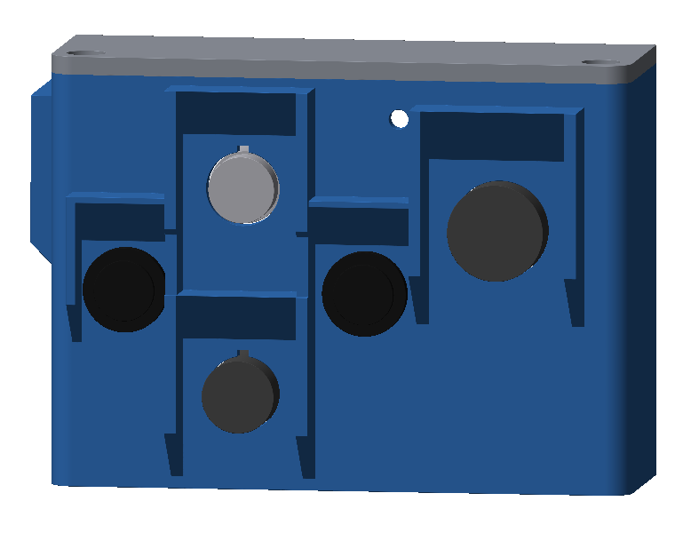

# MoveEye Gehäuse 5.3.1 – Nachtrag zu v5.3

Stand 08.11.2026. **5.3.1 ändert kein Teil von v5.3.** Neu ist nur ein zusätzliches Druckteil, der
**Adapter 28** für das alte Waveshare «UPS HAT», dazu diese Anleitung. Alles andere gilt wie in
[LIESMICH_Montage_v5-3.md](LIESMICH_Montage_v5-3.md).
Quelle: `Quellcode/upsalt531.py`. Die Datei importiert `v53.py`, `v52.py` und `v5.py` und ändert sie nicht.

| Neu | Datei |
|---|---|
| 28 Adapter altes UPS HAT (provisorisch) | [Druckdateien/v5-3/MoveEye_v5-3_28_Adapter_UPS_HAT_alt.3mf](../Druckdateien/v5-3/MoveEye_v5-3_28_Adapter_UPS_HAT_alt.3mf) |

## Provisorisch: alter UPS HAT

Für die Zeit, bis das UPS HAT (E) da ist: das ältere **Waveshare «UPS HAT»** (SKU 18306, «UPS HAT (EU)», später auch als UPS HAT (A)
verkauft) mit **2 × 18650** in Serie im unveränderten Gehäuse v5.3. **Deckel zu, nur drinnen oder auf dem Tisch.**

### Warum so

Das HAT ist von der Unterseite bis zur Oberkante der Zellen **38 mm** hoch (gemessen). Damit gibt es nur eine saubere Lösung:

- **HAT im Service-Fenster:** geht nicht. Die 8,4-V-Buchse müsste über z 38,75 liegen, die Zellen kämen dann bis ca. z 80, der
  Deckel liegt bei 68,5.
- **HAT neben dem Pi:** geht nicht. Nirgends im Gehäuse ist ein freier Platz von 85 × 56 × 38 mm. Unter dem Pi in der Lage von
  v5.3 bleiben nur ca. 35 mm, der Zwischenboden 09 ist zu klein.
- **Gewählt: tief und gedreht.**
  - Der Pi 5 liegt flach auf dem Adapter im Akku-Zaun (Unterseite z 8) und ist um 180° gedreht. Seine HDMI-/USB-C-Kante zeigt
    nach innen (+y), USB/Ethernet zur Stirnseite.
  - Das HAT steckt **wie von Waveshare vorgesehen** auf dem Pi, mit GPIO-Verlängerung und Abstandsbolzen.
  - Der **Active Cooler bleibt**.
  - Geladen wird über eine **Einbaubuchse 5,5/2,1 in der Reserve-Öffnung hinten** (Ø 12,3, wo sonst Blindstopfen 17 sitzt).
    Ein kurzes Kabel mit Winkelstecker führt von dort in die 8,4-V-Buchse des HAT.

Die Rechnung nimmt den **schlimmsten Fall**: 38 mm ab der Platine des HAT. Wahrscheinlich hat der Besitzer ab der Unterkante der
schwarzen Buchsenleiste gemessen. Dann sind es ab der Platine 29,5 mm. Das passt genau zu Waveshares «42,05 mm Gesamthöhe auf
dem Pi» (1,6 Pi + 2,5 Stiftleiste + 38). Beides passt unter den Deckel.

### Was läuft, was nicht

- Am alten HAT hängen **nur der Pi 5 und die Kameras**. Er gibt den Strom über die GPIO-Leiste (5 V, laut Waveshare bis 2,5 A).
- **Servos, Licht und Lautsprecher** laufen nicht über dieses HAT. Sie bleiben aus oder bekommen eine eigene Versorgung.
  Die Verdrahtung von v5 (B+ / B− des UPS HAT (E) → Sicherung → Step-down) **gilt hier nicht**.
- **Geladen wird am HAT selbst:** das mitgelieferte **Ladegerät 8,4 V / 2 A** kommt in die neue Einbaubuchse hinten, und von dort
  führt ein Kabel direkt in die 8,4-V-Buchse des HAT.
- **Die GX16-Ladebuchse und der Pololu-Lader (5-V-Pfad) werden nicht an dieses HAT angeschlossen.**

### Aufbau (von unten nach oben)

1. **Adapter 28** im Akku-Zaun, an der Stelle von UPS HAT (E) und Zellen. Es ist ein flacher Rahmen mit 4 Bolzen (z 2,5–8), wie
   beim Entwicklungs-Sockel 13 gehalten von Klemmrippen am Zaun. Die Akkuklappe 26 bleibt zu.
2. **Pi 5 mit Active Cooler**, gedreht. Er belegt x 76–161 und y 9–65, die USB/Ethernet-Seite zeigt zur Stirnseite (x 74).
   Die 4 Abstandsbolzen M2,5 × 17 (Aussengewinde unten) gehen durch die Löcher des Pi in die Bolzen des Adapters.
3. **GPIO-Verlängerung** («Booster Header») auf die Stiftleiste des Pi, dann das **UPS HAT** darauf. Es liegt 17 mm über dem Pi,
   mit 4 × M2,5 × 6 von oben in die Abstandsbolzen. Die Buchsen des HAT (8,4 V, USB-A, Schalter) zeigen nach +y ins Gehäuse.
4. **Ladekabel:** Den Winkelstecker 5,5/2,1 in die 8,4-V-Buchse des HAT stecken. Das Kabel (ca. 15 cm) läuft unter der
   Buchsen-Kante nach +x und an der Rückwand hoch zur **Einbaubuchse in der Reserve-Öffnung** (Mutter innen).
   **Polarität wie am Ladegerät** (Mitte +, bitte am Original-Stecker prüfen).
5. **Kamerakabel** wie unten, dann den Deckel zu. **Stopfen 10 bleibt im Service-Fenster.**

### Was am Modell geprüft ist (`python3 check531.py`)

| Was | Abstand |
|---|---|
| Zellen → Deckel | **3,9 mm** im schlimmsten Fall (38 mm ab Platine), **12,4 mm** im wahrscheinlichen Fall (29,5 mm) |
| Lüfter (Active Cooler) → HAT-Platine | 2,6 mm (bei 17 mm Abstand) |
| Pi → Unterteil / Akku-Zaun | 1,8 mm |
| Halter der Zellen → Unterteil / Zwischenboden 09 | 1,7 mm / 2,9 mm |
| Winkelstecker → Unterteil | 4,4 mm |
| Ladebuchse (Gewinde Ø 11) in der Reserve-Öffnung Ø 12,3 | 0,55 mm; zur Taste daneben 3,3 mm |
| Kabel CAM0 / CAM1 | mindestens 2,0 mm zum Deckel, 0,25 mm am Winkelstecker (CAM1, flach darunter) |

### Was draussen bleibt (die Teile selbst sind unverändert)

- **Luftkanal 27**: Die Haube liegt bei v5.3 auf dem Kühler in z 55; hier stösst sie an die Zellen.
- **Blindstopfen 17**: An seiner Stelle sitzt die Ladebuchse.
- **UPS HAT (E)** mit 4 × 21700 und der Entwicklungs-Sockel 13.
- **Zwischenboden 09** (mit Pololu-Lader und INA219) **darf drin bleiben** (2,9 mm Luft). Der Pololu-Lader wird aber nicht
  angeschlossen.

### Was man nur bei offenem Deckel erreicht

- **Schalter ON/OFF** des HAT, an der Buchsen-Kante innen. Im Betrieb bleibt er auf ON; den Pi in MoveEye herunterfahren.
  Zum Lagern oder für den Transport den Deckel öffnen und auf OFF stellen.
- **USB-A (5V OUT)** des HAT. Für Pi und Kameras wird er nicht gebraucht.
- **WARNING-LEDs** (Verpolung): Sie zeigen nur beim Einsetzen der Zellen etwas, dann schaut man sowieso von oben.
- **USB-C und HDMI des Pi** liegen jetzt innen und nicht mehr hinter dem Service-Fenster. Strom bekommt der Pi über die GPIO-Leiste.
  Für HDMI im Notfall den Deckel öffnen.
- **SD-Karte:** Sie steckt jetzt unten an der Rückwand-Seite des Pi (x 161). Am besten wie in v5.2 die microSD-Verlängerung zum
  Schlitz in der Lüftungswand legen.

### Kamerakabel

Die Buchsen CAM/DISP 0 und 1 liegen jetzt unter dem HAT bei x 109 / 112, y 57, direkt unter der 8,4-V-Buchse des HAT.
Vorschlag aus dem Modell, gelb im Bild oben:

- **CAM0 (Kopf):** vom Kabelkamin über die Zellen nach +y (im schlimmsten Fall 2 mm unter dem Deckel). Neben der
  Buchsen-Kante, links vom Winkelstecker, hinunter, dann unter dem HAT flach zur Buchse. **ca. 95 mm** (v5.3: 75 mm).
- **CAM1 (Weitwinkel):** wie v5.2 bis unter den Pan-Servo, über die Hub-Ablage nach +y, hinter dem Winkelstecker hinunter, dann
  flach unter Stecker und HAT zur Buchse. **ca. 160 mm** (v5.3: 155 mm).
- Den Kabelkamm an der Lüftungswand braucht es dafür nicht.

### Luft

Der Active Cooler saugt unter dem HAT an. Bei 17 mm Abstand sind es nur 2,6 mm bis zur HAT-Platine, aber der Raum unter dem HAT
ist auf allen Seiten offen. Die warme Luft geht wie bisher durch die Lüftungsschlitze (−y) und den Einlass hinaus.

**Mit 19 mm Abstand** (z. B. Bolzen 17 + 2 mm Scheiben und eine passende Verlängerung) hat der Lüfter 4,6 mm. Die Zellen bleiben
dann im schlimmsten Fall 1,9 mm unter dem Deckel. Mehr geht nicht, ausser die 38 mm sind sicher ab der Buchsenleiste gemessen.
Temperatur mit `vcgencmd measure_temp` beobachten.

### Druck

| Teil | Lage | Material | Schicht | Wände | Füllung | Stützen | Brim | Zeit / Gewicht |
|---|---|---|---|---|---|---|---|---|
| 28 Adapter altes UPS HAT | Rahmen unten, Bolzen oben (wie eingebaut) | PETG | 0,20 mm | 3 | 15 % | keine | keiner | ca. 30 min, ca. 10 g |

Masse ca. 92 × 79 × 5,5 mm. Prüfen im Ordner `Quellcode/`: `python3 check531.py` (Kollisionen, Höhen, Ladebuchse, Kabel),
`python3 printcheck531.py` (Überhänge, Inseln), `python3 druckcheck531.py` (Wandstärken), Bilder `python3 prev531.py` (nach `out531/`,
Kopien in `Bilder/Vorschau_v5-3-1_*.png`). Neu erzeugen: `python3 export531.py` (STL nach `out531/`, 3MF nach `Druckdateien/v5-3/`).

### Zusätzliche Teile

| Menge | Was | Wofür |
|---|---|---|
| 4 | Abstandsbolzen M2,5 × 17 mm, Innen-/Aussengewinde (Aussengewinde ≥ 5 mm) | durch die Pi-Löcher in die Bolzen des Adapters (Kernloch Ø 2,2, durchgehend 5,5 mm), tragen das HAT |
| 4 | Schraube M2,5 × 6 | oben durch das HAT (Loch Ø 3,0) in die Abstandsbolzen |
| 1 | GPIO-Verlängerung 2 × 20 («Booster Header», passend zu 17 mm, z. B. Pimoroni) | Pi-Stifte → Buchsenleiste des HAT |
| 1 | Einbaubuchse Hohlstecker 5,5/2,1 für Loch 11–12 mm, mit Mutter (z. B. DC-022B), ≥ 3 A | Ladebuchse in der Reserve-Öffnung hinten |
| 1 | Kabel ca. 15–20 cm, 2 × 0,5 mm², mit **Winkelstecker 5,5/2,1** (90°) | von der Einbaubuchse in die 8,4-V-Buchse des HAT |
| – | Active Cooler wie bisher | bleibt |
| ggf. 1 | längeres Flachkabel für CAM1 / CAM0 | wenn die vorhandenen nicht reichen (siehe Längen oben) |

Ohne Abstandsbolzen mit Aussengewinde: Bolzen Innen/Innen und unten je einen Gewindestift M2,5 × 10. Statt der GPIO-Verlängerung
gehen auch 6 kurze Kabel (2 × 5 V, 2 × GND, SDA, SCL); dann muss das HAT trotzdem auf den 4 Bolzen sitzen.

### Warnungen

- **2S Li-Ion (bis 8,4 V).** Nur mit dem **Ladegerät 8,4 V / 2 A** von Waveshare laden, über die neue Buchse. Waveshare warnt,
  dass andere Netzteile das Modul zerstören können.
- **Die Einbaubuchse hinten ist nur für dieses Ladegerät.** Das Gehäuse beschriften («8,4 V – nur Original-Ladegerät»).
  **Nie den GX16-/Pololu-/5-V-Pfad von MoveEye an dieses HAT anschliessen.** Auch nicht gleichzeitig ein USB-C-Netzteil am Pi.
- Polarität des Ladekabels prüfen, bevor zum ersten Mal geladen wird (Messgerät an der Einbaubuchse und am Winkelstecker).
- **Nur drinnen**, auf einer nicht brennbaren Unterlage, nicht unbeaufsichtigt laden.
- Zellen 18650 **ohne Schutzplatine**, Länge unter 67 mm (Angabe Waveshare), beide gleich (Typ, Ladezustand). Nach dem Einsetzen
  die **WARNING-LEDs** prüfen: Leuchtet eine, ist eine Zelle verkehrt herum. Dann nicht laden.
- **Strom:** Das HAT gibt laut Waveshare 5 V mit bis zu 2,5 A. Für Pi 5 und Kameras sollte das reichen, nicht aber für viel
  USB-Last. Meldet der Pi Unterspannung, USB-Geräte abziehen.

### Software

Keine Änderung nötig. MoveEye erkennt das ältere HAT selbst:

- `quelle/100_akku.py`, `ups_tick`: Mit `ups_model` «auto» zuerst das UPS HAT (E) auf 0x2D, sonst der INA219 auf `ups_addr`.
- `quelle/020_einstellungen.py`: Voreinstellung `"ups_addr": "0x42"`.
- Akku-% kommt aus der Spannung (2S). Unter Akku `ups_mah` auf die Kapazität **einer** Zelle stellen, z. B. 3400 mAh.

### Masse

Aus der **Masszeichnung von Waveshare** (Draufsicht, ausgemessen auf ca. ±0,5 mm):

- Platine 56 × 85, Löcher Ø 3,0, Lochbild 58 × 49 (23,5 / 3,5 / 3,5), also gleich wie beim Pi
- 8,4-V-Buchse x 47,3, steht 2,8 mm vor
- USB-A x 31,5
- Schalter x 16,2, der Schieber steht 4,5 mm vor
- WARNING-LEDs x 69,5–78,5
- Batteriehalter x 1,7–84,4, y 7,6–49,8

x zählt ab der Pi-Seite ohne USB, y ab der Kante mit den Buchsen. **Gemessen** (Besitzer): 38 mm von der Unterseite bis zur
Oberkante der Zellen. Geprüft (Waveshare-Wiki / Produktseite): 2 × 18650 unter 67 mm, Ladegerät 8,4 V / 2 A, Ausgang
5 V / 2,5 A, INA219 auf 0x42, «Gesamthöhe 42,05 mm auf dem Pi».

**NACHMESSEN** (Parameter oben in `Quellcode/upsalt531.py`):

| Was | Parameter | Annahme | Warum wichtig |
|---|---|---|---|
| Die 38 mm: ab Platine oder ab Unterkante der Buchsenleiste? | `HAT_MESS`, `HAT_TOP_H` | gerechnet mit 38 ab Platine | Luft zum Deckel 3,9 oder 12,4 mm |
| Abstand Pi → HAT mit der gekauften GPIO-Verlängerung | `HAT_GAP` | 17 mm | Bolzenlänge; bis 19 mm passt es im schlimmsten Fall |
| Active Cooler Höhe | `COOL_H` | 14,4 mm | Luft über dem Lüfter |
| Höhen unten am HAT (Buchse, USB-A, Schalter, Spule) | `JACK_H`, `JACK_AXIS`, `USBA_H`, `SW_H`, `IND_*` | höchstens 7,5 mm (wie die Buchsenleiste) | Luft über Pi und Kühler |
| Stifte der Stapelleiste oben am HAT | `PINS_TOP` | 10 mm | Höhe neben den Zellen |
| Winkelstecker, Einbaubuchse | `PLUG90_*`, `DCB_*` | Ø 10 × 11 / Ø 12 × 16 mm | Platz an der Buchsen-Kante und hinten |
| Lage der Buchsen CAM/DISP am Pi 5 (wie v5.2) | `v52.PI_CAM*_XY` | 8 mm von der HDMI-Kante | Kabel unter dem HAT |

Wenn ein Mass anders ist: den Parameter ändern, `python3 check531.py` laufen lassen, dann `python3 export531.py`.

## Nicht getestet

Nur am Modell berechnet und geprüft (Kollisionen, Höhen, Überhänge). Der Adapter ist **nicht gedruckt** und nicht mit dem echten
HAT zusammengebaut. Nicht gemessen ist:

- ob der Active Cooler mit 2,6 mm Luft unter dem HAT genug Luft bekommt
- ob die 2,5 A des HAT für Pi 5 und Kameras reichen
- ob die vorhandenen Kamerakabel lang genug sind
