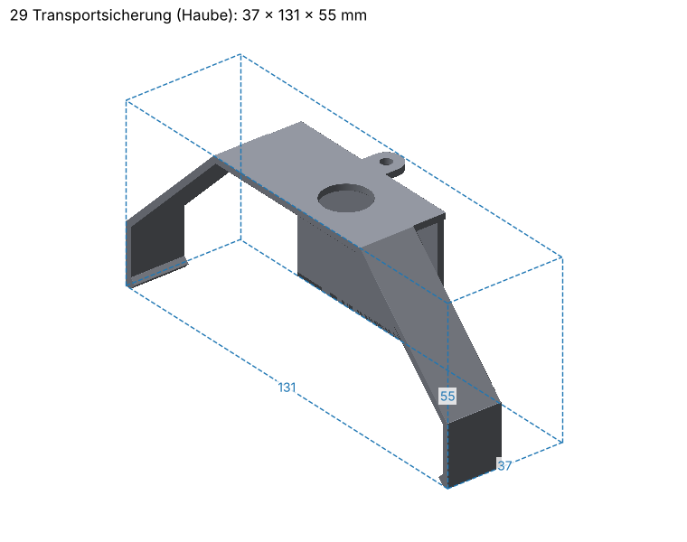
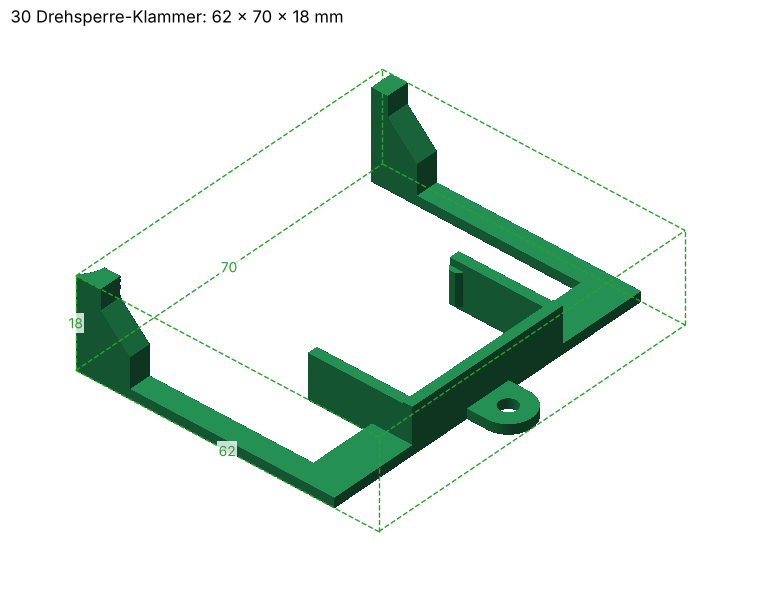
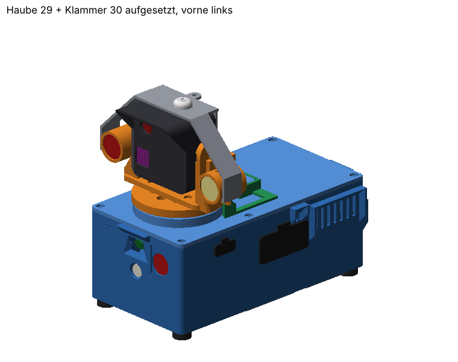
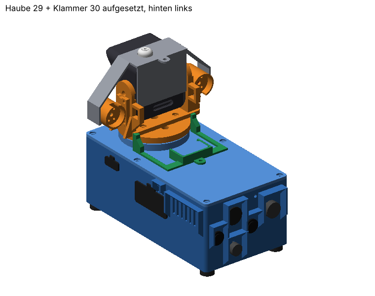
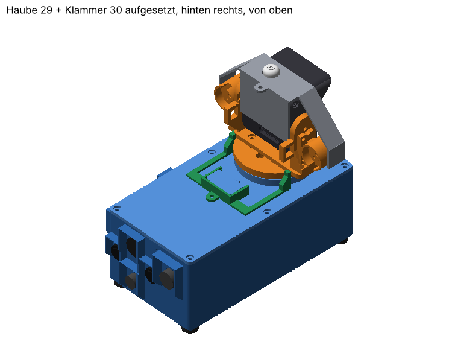

# MoveEye Gehäuse 5.4.0 – Transportsicherung (Haube 29 + Drehsperre-Klammer 30)

Stand 14.11.2026. **5.4.0 ändert kein bestehendes Teil.** Neu sind zwei zusätzliche Druckteile für den Transport im Rucksack,
dazu diese Anleitung.
- Die **Haube 29** sperrt das Neigen.
- Die **Drehsperre-Klammer 30** sperrt das Schwenken.

Beide passen auf v5.3 und ebenso auf v5.1 / v5.2: Kopf, Gabel, Lampen, Drehteller und Kabelkamin sind dort gleich. Auf dem
Kopf v5.1 fehlt der Diffusor, der die Haube vorne / hinten hält.

Quelle: `Quellcode/kappe540.py` (Haube) und `Quellcode/klammer540.py` (Klammer). Sie importieren `v53.py`, `v52.py`, `v5.py`
und `pantilt.py` und ändern sie nicht.

| Neu | Datei |
|---|---|
| 29 Transportsicherung (Haube) | [Druckdateien/v5-3/MoveEye_v5-3_29_Transportsicherung.3mf](../Druckdateien/v5-3/MoveEye_v5-3_29_Transportsicherung.3mf) |
| 30 Drehsperre-Klammer | [Druckdateien/v5-3/MoveEye_v5-3_30_Drehsperre_Klammer.3mf](../Druckdateien/v5-3/MoveEye_v5-3_30_Drehsperre_Klammer.3mf) |

## Grösse

| Teil | Masse | Gewicht |
|---|---|---|
| 29 Haube (mit Öse) | 37 × 131 × 55 mm | ca. 17 g |
| 30 Klammer (mit Öse) | 62 × 70 × 18 mm | ca. 5 g |

Die erste Kappe (Runde 1, bis zum Kabelkamin) mass 82 × 131 × 86 mm. Die Breite der Haube von 131 mm geben die beiden Lampen
vor (aussen 127 mm).

## Wie sie halten

### Haube 29: Neigen gesperrt (Spiel ± 0,5°)

- Der Kopf liegt zwischen:
  - dem **Dach** (0,5 mm über dem Kopf),
  - der **Rückwand** (0,3 mm hinter dem Kopf, zwischen den Armen über und unter der Kippachse; sie endet 4,5 mm über dem
    Kabelschlitz des Kopfs),
  - und den **Lampenbechern**. Die Lampen sind an die Arme der Gabel geschraubt, so hält die Haube den Kopf gegen die Gabel.
- **Rasten:** Die kurzen Seitenwände haben je eine **Rastlippe**. Sie schnappt 1,4 mm unter die dickste Stelle des
  Lampenbechers; die Seitenwände federn dabei 1,4 mm aus. Das Loch für den Diffusor der Status-LED (0,3 mm Passung) hält die
  Haube vorne / hinten.
- **Vorne ist alles offen.** Kein Material liegt vor x 24, 1 mm hinter der vordersten Linsen-Ebene (Lampen x 23, Kamera x 22,
  Wärmebild x 21). Hinten endet sie über den Lampen vor dem Kabelschlitz der Lampenhalter.
- Die Haube dreht mit dem Kopf. Das Schwenken sperrt die Klammer 30.

### Klammer 30: Schwenken gesperrt (Spiel + 0,6° / − 0,5°)

- Sie liegt **flach auf dem Deckel**: ein U um den **Kabelkamin** (Seitenwände und Rückwand mit 0,3 mm Luft) hält sie in Lage.
  Je eine **Rastnase** an den Seitenwänden schnappt 1 mm vor die runden vorderen Ecken des Kamins.
- Zwei schmale Arme laufen aussen an der Kabelschlaufe vorbei zu **zwei Pfosten**. Sie stehen neben dem Rand des Drehtellers an
  den hinteren Ecken des Gabelbodens (0,3 mm). Dreht der Kopf, stösst der Gabelboden an einen der Pfosten.
- Die Pfosten stehen unter den **Kabelbügeln** an den Armen der Gabel. Die Klammer wird darum **von hinten** eingeschoben und
  kann nicht abgehoben werden: nach 4,2 mm stossen die Pfosten an die Kabelbügel, die Rastnasen greifen dann noch.
- Warum am Kamin und nicht an den Längsseiten des Deckels: Die Längsseiten haben nichts, woran die Klammer in Längsrichtung
  anstehen könnte; sie würde beim Drehen des Kopfs entlang rutschen. Der Kamin ist das einzige feste Teil in Reichweite mit
  Flächen in beide Richtungen.
- Der Kabeleingang vorne im Kamin bleibt frei.

### Ösen

Beide Teile haben hinten eine flache **Öse** (Loch Ø 3,6, 3 mm Material rundum) für eine Schnur oder einen Schlüsselring. So
bleiben Haube und Klammer zusammen. Die Öse der Klammer ist auch der Griff zum Herausziehen.

## So setzt du sie auf

1. MoveEye herunterfahren und den Strom trennen.
2. Den Kopf von Hand in die **Grundstellung** drehen. Er schaut nach vorne zu PIR und Mikrofon und steht waagrecht.
3. **Haube 29** mit einer Hand von oben über Kopf und Lampen drücken (Status-LED durch das Loch im Dach), bis sie an beiden
   Lampenbechern **einrastet**.
4. **Klammer 30** flach von hinten über den Deckel zum Kopf hin schieben: die Pfosten gehen unter den Kabelbügeln durch an den
   Gabelboden, die Seitenwände um den Kabelkamin, bis beide Rastnasen **einrasten**.
5. Die beiden Ösen mit einer Schnur verbinden (sinnvoll, wenn die Teile oft mitkommen).
6. **Abnehmen:** zuerst die Klammer an der Öse nach hinten ziehen, dann die Haube gerade nach oben abziehen.
7. **Vor dem Einschalten beide abnehmen.**

## Was am Modell geprüft ist (`python3 check540.py`)

**Haube 29**

| Was | Abstand / Ergebnis |
|---|---|
| Dach → Kopf oben / Rückwand → Kopf hinten / Diffusor | 0,5 / 0,3 / 0,3 mm (Anlage) |
| Seitenwand → Lampenbecher; Rastlippe | 0,3 mm; Lippe liegt am Becher an, 1,4 mm unter der dicksten Stelle |
| Tilt-Horn (im Arm 1) / Gabel / Arm 2 | 1,65 / 2,15 / 2,35 mm |
| Tilt-Servo / Pan-Servo / Pan-Horn | 4,05 / 36 / 32 mm |
| Kabelschlaufe Kopf → Kamin (Modell Ø 8) / Lampenkabel (Ø 4) | 4,8 / 4,65 mm |
| Sichtfeld Kamera (gerechnet mit Weitwinkel 102° × 67° + 2°) | frei, 9,6 mm; Haube 2,3 mm hinter der Linsen-Ebene |
| Sichtfeld Wärmebild (90° + 2°) | frei, 18,7 mm |
| Lichtkegel Lampen weiss / IR (gerechnet 120°) | frei, 1,8 / 1,7 mm; Haube 1,3 mm hinter der Linsen-Ebene |
| Weitwinkel v5.2 vorne, PIR, Mikrofon | frei, 40 / 77 / 46 mm |
| Aufsetzen senkrecht von oben | geht (nur die Rastlippen greifen unter die Becher) |
| Spiel Neigen | ± 0,46° |

**Klammer 30**

| Was | Abstand / Ergebnis |
|---|---|
| Gabelboden (Anschlag) / Drehteller-Rand / Kugeln | 0,3 / 0,57 / 3,6 mm |
| Kamin (Seiten, Rückwand, Rastnasen vor den Ecken) | 0,3 mm |
| Arm 2 / Unterteil | 3,3 / 3,6 mm |
| Lampenkabel (Modell Ø 4, angenommene Lage am Gabelboden) | 2,6 mm |
| Flachkabel 16 mm auf der Öse im Kamin / Kabelschlaufe | 6,6 / 6,7 mm |
| Kamerakabel CAM0 / CAM1 im Unterteil | 3,8 mm |
| Einschieben von hinten (60 mm Weg) | geht: nichts im Weg (die Rastnasen federn am Kamin entlang) |
| Abheben | nach 4,2 mm an den Kabelbügeln, Rastnasen greifen noch |
| Spiel Schwenken | + 0,64° / − 0,49° |

Abstände auf ± 0,25 mm (Raster 0,4–0,5 mm).

## Druck

| Teil | Lage | Material | Schicht | Wände | Füllung | Stützen | Brim | Zeit / Gewicht |
|---|---|---|---|---|---|---|---|---|
| 29 Haube | umgedreht, Dach unten | PETG | 0,20 mm | 3 | 15 % | keine | 5 mm | ca. 1 h, ca. 17 g |
| 30 Klammer | flach, wie eingebaut | PETG | 0,20 mm | 3 | 15 % | keine | keiner | ca. 20 min, ca. 5 g |

- `printcheck540.py`: keine Inseln, keine Überhänge, bei beiden Teilen.
- Wände 2 mm. Die dünnsten Stellen sind die keilförmigen Rastlippen (Haube) und Rastnasen (Klammer), die sich federnd anlegen
  sollen.

Prüfen im Ordner `Quellcode/`:
- `python3 check540.py`: Abstände, Sichtfelder, Kabel, Aufsetzen / Einschieben, Spiel.
- `python3 printcheck540.py`: Überhänge, Inseln.
- `python3 druckcheck540.py`: Wandstärken.
- `python3 prev540.py`: Bilder.

Neu erzeugen: `python3 export540.py`. Die 3MF kommen nach `Druckdateien/v5-3/`, die STL in einen Ordner ausserhalb des
Repositorys (`GEH_STL`).

## Annahmen

| Was | Parameter / Stelle | Annahme |
|---|---|---|
| Abstrahlwinkel der Lampen | `kappe540.SICHT["lampe"]` | 120° (unbekannt; vorne ist ohnehin alles offen) |
| Wärmebild Thermal-90 | `SICHT["waermebild"]` | 90° × 90° + 2° |
| Lage der Kabel | `schlaufe_pts()`, `lampenkabel_pts()` | Mittellinien, Ø 8 / Ø 4; Lampenkabel vom Kabelbügel über den Gabelboden |
| Grundstellung | `placed(0, 180)` | Kopf waagrecht, schaut nach vorne |

## Nicht getestet

Nur am Modell berechnet und geprüft. Die Teile sind **nicht gedruckt** und nicht am echten Gerät aufgesetzt (Testdruck folgt).
Nicht geprüft ist:

- wie fest Rastlippen (Haube) und Rastnasen (Klammer) halten und wie leicht beide wieder abgehen
- ob die Höhen-Toleranzen (Laufring, Kugeln, Gabel, Kopf) zu den 0,5 mm über dem Kopf passen
- ob die Lampenkabel wirklich so am Gabelboden liegen wie angenommen (2,6 mm zu den Pfosten der Klammer)
- ob die Pfosten der Klammer gut unter den Kabelbügeln durchgehen, wenn Kabel an den Bügeln befestigt sind
- der Druck selbst: Brim, die dünnen Rastlippen und Rastnasen
