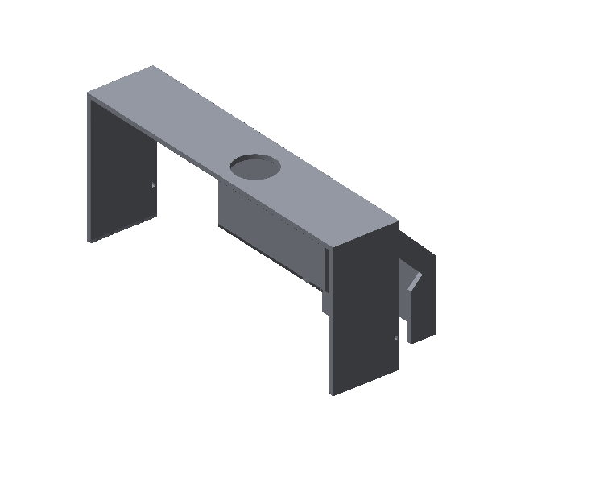
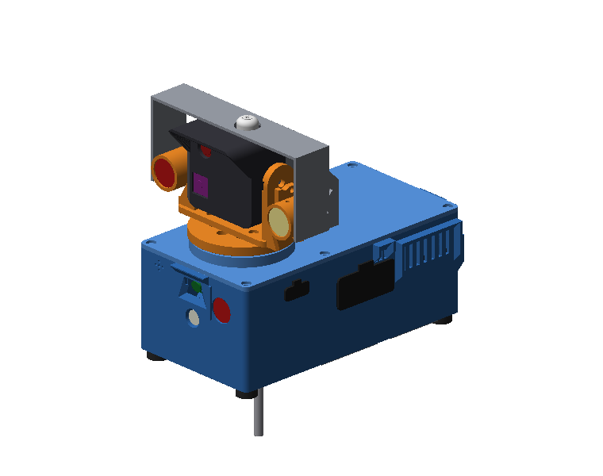
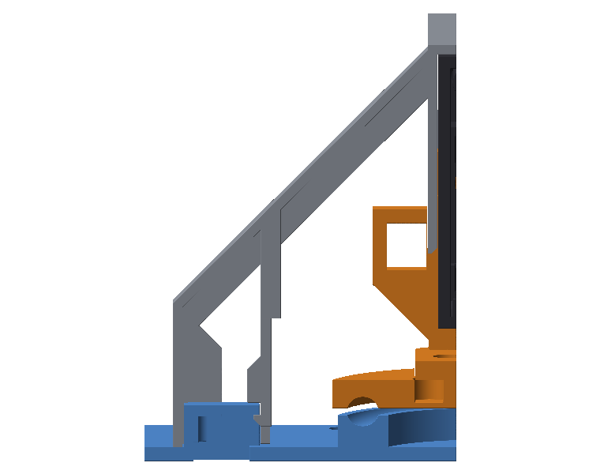

# MoveEye Gehäuse 5.4.0 – Transportsicherung 29

Stand 14.11.2026. **5.4.0 ändert kein bestehendes Teil.** Neu ist ein zusätzliches Druckteil, die **Transportsicherung 29**
(eine Kappe), dazu diese Anleitung. Sie passt auf v5.3 und ebenso auf v5.1 / v5.2: Kopf, Gabel, Lampen und Kabelkamin sind dort gleich.
Quelle: `Quellcode/kappe540.py`. Die Datei importiert `v53.py`, `v52.py`, `v5.py` und `pantilt.py` und ändert sie nicht.

| Neu | Datei |
|---|---|
| 29 Transportsicherung | [Druckdateien/v5-3/MoveEye_v5-3_29_Transportsicherung.3mf](../Druckdateien/v5-3/MoveEye_v5-3_29_Transportsicherung.3mf) |

## Wie sie hält

- **Haube über dem Kopf:**
  - Das **Dach** liegt 0,5 mm über dem Kopf. Ein Loch lässt den Diffusor der Status-LED frei.
  - Die **Rückwand** hat 0,3 mm Luft zur Kopf-Rückseite. Sie reicht über und, in der Mitte zwischen den Armen, unter die
    Kippachse. Sie endet 4,5 mm über dem Kabelschlitz des Kopfs.
  - Die **Seitenwände** liegen mit 0,3 mm aussen an den Lampenbechern.
  - Das sperrt das **Neigen** (Kopf oben und hinten) und das **Schwenken** (Kopf hinten und die Lampen).
- **Vorne ist alles offen.** Kein Material liegt vor x 24, also 1 mm hinter der vordersten Linsen-Ebene (Lampen x 23,
  Kamera x 22, Wärmebild x 21). Kamera, Wärmebild und Lampen können die Kappe darum bei keinem Winkel sehen.
- **Rücken (45°)** über der Kabelschlaufe hinter dem Kopf zum Kabelkamin. Dort sind:
  - **Kurze Wangen und eine Rückwand** hinten um den Kamin (0,3 mm): Lage seitlich und nach vorne.
  - **2 Pfeiler mit Krallen** vor den runden vorderen Kamin-Ecken (0,3 mm): Anschlag nach hinten.
  - Zwischen Pfeiler und Wange bleibt seitlich ein Fenster. Dort erreicht der Finger die Drücker.
  - **2 Rastzungen**, deren Nasen 1,2 mm unter das Dach des Kamins greifen: Sie halten die Kappe unten.
  - Die Kappe steht mit Wangen und Rückwand auf dem Deckel.
- Sie drückt **nicht** auf Servos, Hörner, Kabel oder das Flachkabel (Abstände unten).

## So setzt du sie auf

1. MoveEye herunterfahren und den Strom trennen (die Servos sind dann ohne Strom).
2. Den Kopf von Hand in die **Grundstellung** drehen. Er schaut nach vorne zu PIR und Mikrofon und steht waagrecht.
3. Das Flachkabel liegt mittig auf der Öse im Kamin. Die Kabelschlaufe hängt hinter dem Kopf.
4. Die Kappe von oben über Kopf und Lampen schieben (der Diffusor geht durch das Loch im Dach). Dabei kommt sie hinten über den
   Kabelkamin. Leicht drücken, bis **beide Zungen hörbar einrasten** und die Kappe auf dem Deckel steht. Die Schrägen innen
   unten führen den Kopf in die richtige Lage, wenn er leicht verdreht ist.
5. **Abnehmen:** Die beiden **Drücker** oben an den Zungen (über dem Kamin-Dach, durch das seitliche Fenster) zum Kopf hin
   drücken, die Kappe hinten anheben und nach oben abziehen.
6. **Vor dem Einschalten abnehmen.** Sonst drücken die Servos gegen die Kappe.

## Was am Modell geprüft ist (`python3 check540.py`)

| Was | Abstand / Ergebnis |
|---|---|
| Dach → Kopf oben | 0,5 mm (Anlage) |
| Rückwand → Kopf hinten, Seitenwände → Lampenbecher | 0,3 mm (Anlage) |
| Wangen / Rückwand / Krallen → Kabelkamin | 0,3 mm; Nase 1,2 mm unter dem Dach, 0,3 mm Luft nach oben |
| Diffusor Status-LED | 1,5 mm (rundum) |
| Tilt-Horn (im Arm 1) / Gabel / Arm 2 | 1,6 / 2,1 / 2,3 mm |
| Tilt-Servo / Pan-Servo / Pan-Horn | 4,0 / 35 / 32 mm |
| Kamera / Wärmebild (Teile) | 7,0 / 20 mm |
| Kabelschlaufe Kopf → Kamin (Modell Ø 8) | 4,5 mm |
| Lampenkabel (Becher → Kabelbügel, Ø 4) | 4,8 mm |
| Flachkabel auf der Öse, 16 mm / 12 mm breit | 1,15 / 3,15 mm (Zungen ganz aussen in der Kamin-Öffnung) |
| Öse im Kamin | 5,2 mm |
| Sichtfeld Kamera (gerechnet mit Weitwinkel 102° × 67° + 2°) | frei, 11 mm; Kappe 2,3 mm hinter der Linsen-Ebene |
| Sichtfeld Wärmebild (90° + 2°) | frei, 29 mm |
| Lichtkegel Lampen weiss / IR (gerechnet 120°) | frei, 2,5 mm; Kappe 1,3 mm hinter der Linsen-Ebene |
| Weitwinkel v5.2 vorne in der Stirnwand, PIR, Mikrofon | frei, 40 / 68 / 45 mm |
| Aufsetzen senkrecht von oben | geht: kein Teil des Geräts liegt über der Kappe (nur die Nasen federn aus) |
| Spiel Schwenken / Neigen bis zum Anschlag | ± 0,5° / + 1,1° − 0,5° |

Abstände auf ± 0,25 mm (Raster 0,5 mm).

## Druck

| Teil | Lage | Material | Schicht | Wände | Füllung | Stützen | Brim | Zeit / Gewicht |
|---|---|---|---|---|---|---|---|---|
| 29 Transportsicherung | umgedreht, Dach unten | PETG | 0,20 mm | 3 | 15 % | keine | 5 mm | ca. 2 h, ca. 35 g |

- Masse 82 × 131 × 86 mm (Druckhöhe 86 mm).
- Wände 2 mm, Zungen 2,2 × 2,6 mm.
- Die Zungen biegen beim Einrasten 1,2 mm aus. Das gibt 0,75 % Dehnung und etwa 1,4 N Federkraft. Die Nase hält mit einer
  waagrechten Rastfläche, nicht mit der Federkraft.

Prüfen im Ordner `Quellcode/`:
- `python3 check540.py`: Abstände, Sichtfelder, Kabel, Aufsetzen, Spiel.
- `python3 printcheck540.py`: Überhänge, Inseln.
- `python3 druckcheck540.py`: Wandstärken.
- `python3 prev540.py`: Bilder.

Neu erzeugen: `python3 export540.py`. Die 3MF kommt nach `Druckdateien/v5-3/`, die STL in einen Ordner ausserhalb des
Repositorys (`GEH_STL`).

## Annahmen

| Was | Parameter / Stelle | Annahme |
|---|---|---|
| Abstrahlwinkel der Lampen | `kappe540.SICHT["lampe"]` | 120° (unbekannt; vorne ist ohnehin alles offen) |
| Wärmebild Thermal-90 | `SICHT["waermebild"]` | 90° × 90° + 2° |
| Breite des Flachkabels im Kamin | `flachkabel_kamin()` | 16 mm (Camera Module 3), mittig auf der Öse |
| Lage der Kabelschlaufe | `schlaufe_pts()` | Mittellinie Kabelschlitz → Öse, Ø 8 |
| Grundstellung | `placed(0, 180)` | Kopf waagrecht, schaut nach vorne |

## Nicht getestet

Nur am Modell berechnet und geprüft. Die Kappe ist **nicht gedruckt** und nicht am echten Gerät aufgesetzt. Nicht geprüft ist:

- ob die Zungen sauber einrasten und sich mit den Drückern gut lösen lassen (Federkraft, Nase 1,2 mm)
- ob die Höhen-Toleranzen (Laufring, Kugeln, Gabel, Kopf) zu den 0,5 mm über dem Kopf passen
- ob das Flachkabel im Kamin wirklich mittig liegt (bei 16 mm Breite bleiben nur 1,15 mm zu den Zungen)
- wie gut die Sperre bei echten Stössen hält (Spiel ± 0,5°, Kopf gegen PETG)
- der Druck selbst: Brim, Verzug der langen Dachplatte, die kleinen Nasen
