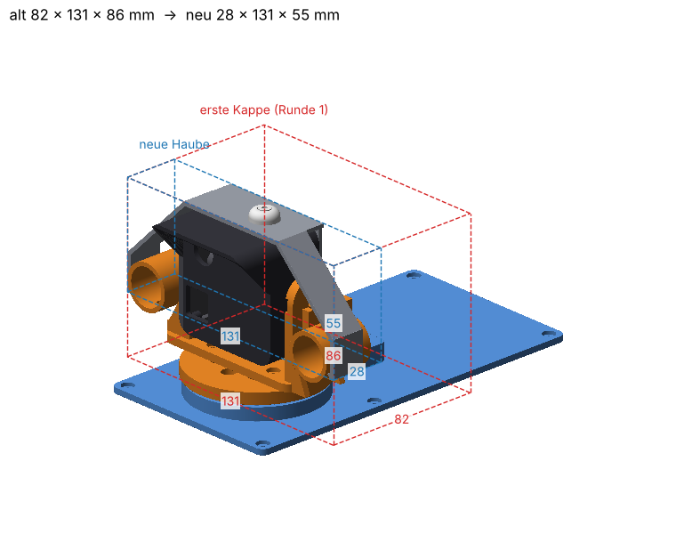

# MoveEye Gehäuse 5.4.0 – Transportsicherung 29

Stand 14.11.2026. **5.4.0 ändert kein bestehendes Teil.** Neu ist ein zusätzliches Druckteil, die **Transportsicherung 29**,
dazu diese Anleitung. Das Teil ist eine kleine Haube über Kopf und Lampen.
Sie passt auf v5.3 und ebenso auf v5.1 / v5.2: Kopf, Gabel und Lampen sind dort gleich. Auf dem Kopf v5.1 fehlt der Diffusor, der
die Haube vorne / hinten hält.

Quelle: `Quellcode/kappe540.py`. Die Datei importiert `v53.py`, `v52.py`, `v5.py` und `pantilt.py` und ändert sie nicht.

| Neu | Datei |
|---|---|
| 29 Transportsicherung | [Druckdateien/v5-3/MoveEye_v5-3_29_Transportsicherung.3mf](../Druckdateien/v5-3/MoveEye_v5-3_29_Transportsicherung.3mf) |

## Grösse

Die Haube misst **28 × 131 × 55 mm** und wiegt ca. 16 g. Die erste Kappe (Runde 1, bis zum Kabelkamin) mass 82 × 131 × 86 mm,
die Haube braucht also noch **22 %** von deren Hüllquader.
Die Breite von 131 mm geben die beiden Lampen vor (aussen 127 mm).

## Wie sie hält

- **Neigen gesperrt** (Spiel ± 0,5°). Der Kopf liegt zwischen:
  - dem **Dach** (0,5 mm über dem Kopf),
  - der **Rückwand** (0,3 mm hinter dem Kopf, zwischen den Armen über und unter der Kippachse; sie endet 4,5 mm über dem
    Kabelschlitz des Kopfs),
  - und den **Lampenbechern**. Die Lampen sind an die Arme der Gabel geschraubt, so hält die Haube den Kopf gegen die Gabel.
- **Rasten:** Die beiden kurzen Seitenwände haben je eine **Rastlippe**. Sie schnappt 1,4 mm unter die dickste Stelle des
  Lampenbechers. Beim Aufdrücken federn die Seitenwände 1,4 mm aus.
- **Vorne / hinten:** Das Loch für den Diffusor der Status-LED sitzt mit 0,3 mm Passung und hält die Haube in Lage.
- **Vorne ist alles offen.** Kein Material liegt vor x 24, also 1 mm hinter der vordersten Linsen-Ebene (Lampen x 23,
  Kamera x 22, Wärmebild x 21).
- **Hinten** endet die Haube über den Lampen vor dem Kabelschlitz der Lampenhalter. Die Lampenkabel bleiben frei.
- **Schwenken: nicht gesperrt.** Die Haube sitzt an Kopf und Lampen und dreht mit. Den Kopf hält nur der Pan-Servo (ohne Strom,
  über sein Getriebe).

### Was das für den Transport heisst

- Die Haube schützt Kamera und Wärmebild vor Stössen von oben und hält den **Tilt-Servo** frei von Schlägen. Das ist der
  empfindlichere Servo, weil der Kopf an einem Hebel hängt.
- Der Kopf kann sich im Rucksack mit der Haube drehen, bis zum Anschlag des Pan-Servos (± 90°). Dabei wird das Getriebe des
  MG90S von aussen gedreht.
- **Empfehlung:** MoveEye aufrecht und gepolstert einpacken, so dass nichts seitlich auf Kopf oder Lampen drückt. Nach dem
  Transport den Kopf vor dem Einschalten wieder in die Grundstellung drehen.

### Variante mit Pan-Sperre (nur Vorschlag)

`PAN_BEINE = True` in `kappe540.py`, geprüft mit `python3 check540.py --beine`:

- Zwei Beine gehen hinter den Lampen (x 49,5–52,3) an die Längsseiten des Deckels und klemmen mit 0,2 mm Übermass.
- Kein Spiel; federnd über die Beine, Hebel 11 mm zur Pan-Achse.
- Grösse **28 × 131 × 90 mm**, ca. 18 g.
- Abstände wie bei der Haube; Bein → Lampenkabel 4,8 mm, Bein → Relais-Buchse 3,7 mm.
- Nicht als Druckdatei. Vor einem Druck den Knick der Beine anpassen (`printcheck540.py --beine` meldet dort 16 mm² Überhang).

## So setzt du sie auf

1. MoveEye herunterfahren und den Strom trennen.
2. Den Kopf von Hand in die **Grundstellung** drehen. Er schaut nach vorne zu PIR und Mikrofon und steht waagrecht.
3. Die Haube mit einer Hand von oben über Kopf und Lampen drücken (Status-LED durch das Loch im Dach), bis sie an beiden
   Lampenbechern **einrastet**.
4. **Abnehmen:** gerade nach oben ziehen.
5. **Vor dem Einschalten abnehmen.**

## Was am Modell geprüft ist (`python3 check540.py`)

| Was | Abstand / Ergebnis |
|---|---|
| Dach → Kopf oben / Rückwand → Kopf hinten / Diffusor | 0,5 / 0,3 / 0,3 mm (Anlage) |
| Seitenwand → Lampenbecher; Rastlippe | 0,3 mm; Lippe liegt am Becher an, 1,4 mm unter der dicksten Stelle |
| Tilt-Horn (im Arm 1) / Gabel / Arm 2 | 1,65 / 2,15 / 2,35 mm |
| Tilt-Servo / Pan-Servo / Pan-Horn | 4,05 / 36 / 32 mm |
| Kamera / Wärmebild (Teile) | 6,5 / 20 mm |
| Kabelschlaufe Kopf → Kamin (Modell Ø 8) | 4,8 mm |
| Lampenkabel (Becher → Kabelbügel, Ø 4) | 4,65 mm |
| Sichtfeld Kamera (gerechnet mit Weitwinkel 102° × 67° + 2°) | frei, 9,6 mm; Haube 2,3 mm hinter der Linsen-Ebene |
| Sichtfeld Wärmebild (90° + 2°) | frei, 18,7 mm |
| Lichtkegel Lampen weiss / IR (gerechnet 120°) | frei, 1,8 / 1,7 mm; Haube 1,3 mm hinter der Linsen-Ebene |
| Weitwinkel v5.2 vorne in der Stirnwand, PIR, Mikrofon | frei, 40 / 77 / 46 mm |
| Aufsetzen senkrecht von oben | geht: kein Teil des Geräts liegt über der Haube (nur die Rastlippen unter den Bechern) |
| Spiel Neigen bis zum Anschlag | ± 0,46° |

Abstände auf ± 0,25 mm (Raster 0,5 mm).

## Druck

| Teil | Lage | Material | Schicht | Wände | Füllung | Stützen | Brim | Zeit / Gewicht |
|---|---|---|---|---|---|---|---|---|
| 29 Transportsicherung | umgedreht, Dach unten | PETG | 0,20 mm | 3 | 15 % | keine | 5 mm | ca. 1 h, ca. 16 g |

- Druckhöhe 55 mm, Auflage 1490 mm².
- Wände 2 mm, dünnste Stelle 1,2 mm (an der Rastlippe).
- Schrägen 45°, Rastlippen mit 45°-Flächen.
- `printcheck540.py`: keine Inseln, keine Überhänge.

Prüfen im Ordner `Quellcode/`:
- `python3 check540.py [--beine]`: Abstände, Sichtfelder, Kabel, Aufsetzen, Spiel.
- `python3 printcheck540.py [--beine]`: Überhänge, Inseln.
- `python3 druckcheck540.py`: Wandstärken.
- `python3 prev540.py`: Bilder.

Neu erzeugen: `python3 export540.py`. Die 3MF kommt nach `Druckdateien/v5-3/`, die STL in einen Ordner ausserhalb des
Repositorys (`GEH_STL`).

## Annahmen

| Was | Parameter / Stelle | Annahme |
|---|---|---|
| Abstrahlwinkel der Lampen | `kappe540.SICHT["lampe"]` | 120° (unbekannt; vorne ist ohnehin alles offen) |
| Wärmebild Thermal-90 | `SICHT["waermebild"]` | 90° × 90° + 2° |
| Lage der Kabel | `schlaufe_pts()`, `lampenkabel_pts()` | Mittellinien, Ø 8 / Ø 4 |
| Grundstellung | `placed(0, 180)` | Kopf waagrecht, schaut nach vorne |

## Nicht getestet

Nur am Modell berechnet und geprüft. Die Haube ist **nicht gedruckt** und nicht am echten Gerät aufgesetzt. Nicht geprüft ist:

- wie fest die Rastlippen halten und wie leicht die Haube wieder abgeht (1,4 mm Rast, Seitenwände 2 mm)
- ob die Höhen-Toleranzen (Laufring, Kugeln, Gabel, Kopf) zu den 0,5 mm über dem Kopf passen
- ob der Pan-Servo den Kopf im Rucksack genug hält
- der Druck selbst: Brim, die dünnen Rastlippen
