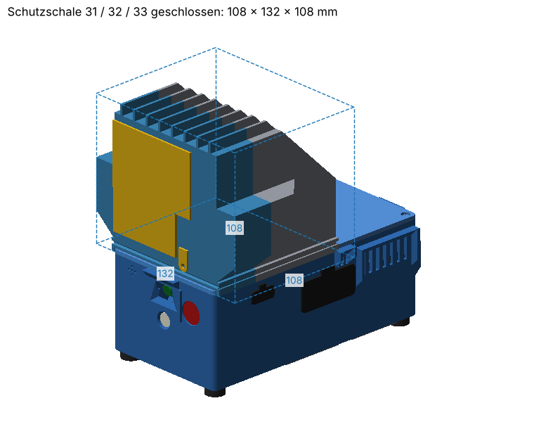
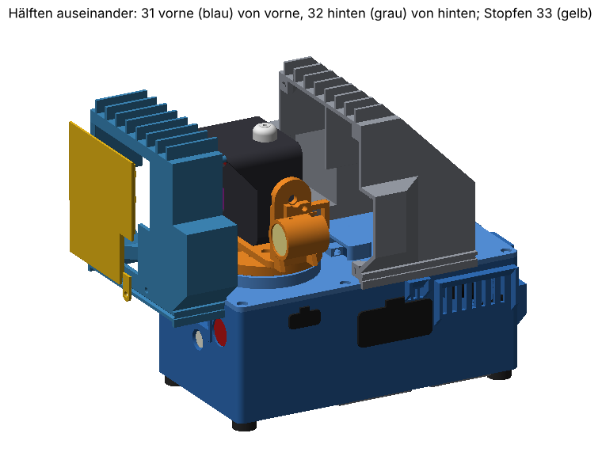
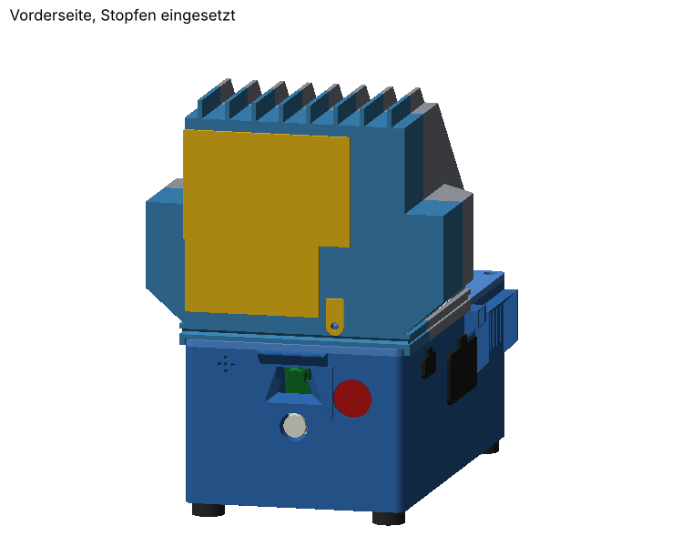
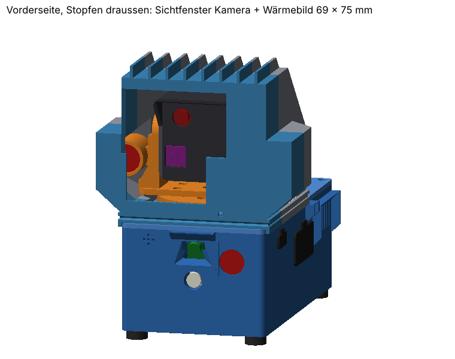
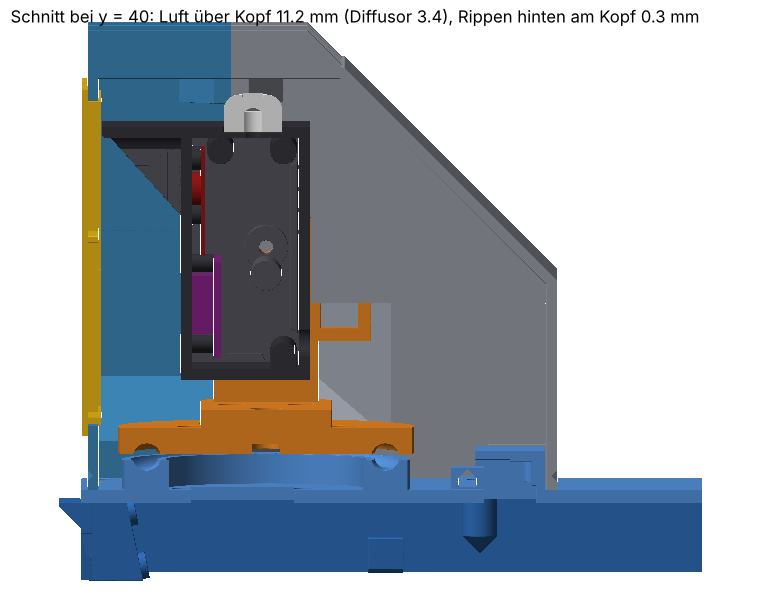
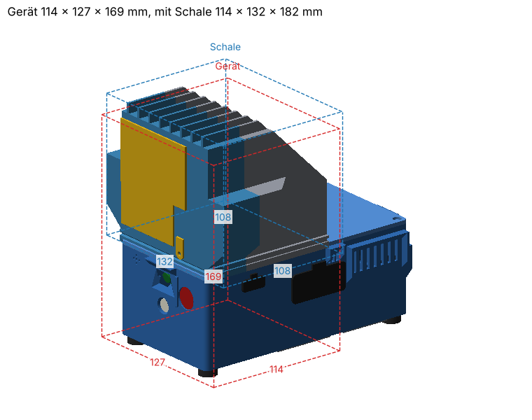

# MoveEye Gehäuse 5.5.0 – Schutzschale (31 vorne, 32 hinten, 33 Stopfen)

Stand 14.11.2026. **5.5.0 ändert kein bestehendes Teil.** Neu sind drei zusätzliche Druckteile, damit MoveEye tief im Rucksack
liegen kann: eine zweiteilige **Schutzschale** über Kopf, Lampen, Gabel, Arm 2 und Drehteller bis auf den Deckel, dazu ein
**Stopfen** für das Sichtfenster. Bis **5 kg** obendrauf gehen über die Schale in den Deckel, nie auf Kopf, Linsen oder Servos.
Die Schale sperrt auch **Schwenken und Neigen** (Haube 29 und Klammer 30 braucht es darunter nicht).

Vorschau vom Besitzer freigegeben (14.11.2026), mit drei Abweichungen vom Auftrag:
- **ein** gemeinsames Fenster mit **einem** Stopfen für Kamera und Wärmebild (die beiden Sichtkegel überschneiden sich an der
  Stirnwand);
- kein eigener Rand ums Fenster: die Stirnwand steht 1 mm vor dem Schirm des Kopfs, ca. 21 mm vor den Linsen, und ist der Rand;
- die Lampen sind abgedeckt.

Die Schale passt auf v5.3 und ebenso auf v5.1 / v5.2 (Kopf, Gabel, Lampen, Drehteller und Kabelkamin sind gleich; gerechnet ist
mit dem Kopf v5.3 mit Diffusor).

Quelle: `Quellcode/schale550.py`. Sie importiert `kappe540.py`, `v53.py`, `v52.py`, `v5.py` und `pantilt.py` und ändert sie nicht.

| Neu | Datei |
|---|---|
| 31 Schutzschale vorne | [Druckdateien/v5-3/MoveEye_v5-3_31_Schutzschale_vorne.3mf](../Druckdateien/v5-3/MoveEye_v5-3_31_Schutzschale_vorne.3mf) |
| 32 Schutzschale hinten | [Druckdateien/v5-3/MoveEye_v5-3_32_Schutzschale_hinten.3mf](../Druckdateien/v5-3/MoveEye_v5-3_32_Schutzschale_hinten.3mf) |
| 33 Stopfen | [Druckdateien/v5-3/MoveEye_v5-3_33_Schutzschale_Stopfen.3mf](../Druckdateien/v5-3/MoveEye_v5-3_33_Schutzschale_Stopfen.3mf) |

## Grösse

| Teil | Masse | Gewicht |
|---|---|---|
| Schale zu (31 + 32 + 33) | 108 × 132 × 108 mm (mit Rippen auf dem Dach) | ca. 170 g |
| 31 vorne | 38 × 132 × 108 mm | ca. 58 g |
| 32 hinten | 75 × 132 × 108 mm | ca. 99 g |
| 33 Stopfen | 4 × 74 × 87 mm (mit Lasche) | ca. 12 g |

Das Gerät misst 114 × 127 × 169 mm, mit Schale 114 × 132 × 182 mm.

## Wie sie hält und trägt

- **Last:** Dach 2,4 mm mit 8 Längsrippen (2 × 8 mm, Abstand 12 mm) oben drauf. Das Dach liegt 3,4 mm über dem Diffusor der
  Status-LED (dem höchsten Punkt des Kopfs). Wände 2,4 mm stehen auf den Deckelrändern; aussen an den Längsseiten des Deckels
  hängen Schürzen. Die Last geht über Dach, Rippen und Wände in den Deckel.
- **Sperre:** In der hinteren Hälfte liegen **zwei Rippen** hinten am Kopf an (0,3 mm, über und unter der Kippachse; sie enden
  4,5 mm über dem Kabelschlitz). Die Wände der seitlichen **Ausbuchtungen** über den Lampen liegen an den Lampenbechern an
  (0,6 mm). Das sperrt Neigen und Schwenken.
- **Teilung** bei x = 32, mitten durch die Lampenbecher. Die vordere Hälfte wird **von vorne**, die hintere **von hinten**
  aufgeschoben (sie steht dann am Kabelkamin an).
- **Steckzapfen:** 4 gedruckte Zapfen Ø 4 × 5 mm an der vorderen Hälfte (in Böcken an den Seitenwänden, oben und unten) gehen
  in Löcher Ø 4,4 × 5,6 mm der hinteren Hälfte. Keine Zusatzteile.
- **Gummiring:** rundum in einer Nut unten (z 73,5–76, an den Längsseiten 2,5 mm breit und 1,2 mm tief, an Stirn- und
  Rückseite als 45°-V). Nutgrund rundum ca. 410 mm. Er hält beide Hälften zusammen.
- **Stopfen 33:** Platte 1,4 mm aussen, Rahmen 1,6 mm im Fenster, Kreuzrippe gegen Eindrücken, 4 Rastnasen (0,5 mm) hinter der
  Stirnwand. Lasche mit Öse Ø 3,6 für die Schnur zum Loch Ø 3,6 unter dem Fenster.
- **Ohne Stopfen** sehen Kamera (auch mit Weitwinkel) und Wärmebild frei durch das Fenster (ca. 69 × 75 mm). Die Lampen bleiben
  abgedeckt.

## So setzt du sie auf

1. MoveEye herunterfahren und den Strom trennen.
2. Den Kopf von Hand in die **Grundstellung** drehen. Er schaut nach vorne zu PIR und Mikrofon und steht waagrecht.
3. **Hintere Hälfte 32** flach auf dem Deckel von hinten nach vorne schieben, bis sie am **Kabelkamin** ansteht.
4. **Vordere Hälfte 31** von vorne aufschieben, bis die vier Zapfen in den Löchern sitzen und die Teilung rundum anliegt.
5. Den **Gummiring** unten rundum in die Nut legen.
6. **Stopfen 33** ins Fenster drücken, bis er einrastet; mit einer Schnur durch seine Öse und das Loch unter dem Fenster sichern.
7. **Abnehmen:** Gummiring ab, vordere Hälfte nach vorne, hintere nach hinten abziehen.
8. **Vor dem Einschalten abnehmen.** Die Schale sperrt Schwenken und Neigen; die Servos würden gegen die Rippen drücken.

Gummiring: flach gelegt ca. 150–170 mm lang (Umfang 300–340 mm), höchstens 2,5 mm breit, z. B. ein Einmachgummi oder ein
O-Ring 2 mm, Innen-Ø ca. 100 mm. Er wird dabei um gut ein Viertel gedehnt.

## Was am Modell geprüft ist (`python3 check550.py`)

| Was | Abstand / Ergebnis |
|---|---|
| Dach → Diffusor / Kopf oben | 3,7 / 11,2 mm |
| Sperr-Rippen → Kopf hinten; Ausbuchtung → Lampenbecher | 0,3 mm; 0,6 mm (Anlage) |
| Tilt-Horn / Gabel / Arm 2 / Tilt-Servo | 3,3 / 3,7 / 3,8 / 4,1 mm |
| Drehteller / Lampenkabel (Modell Ø 4) | 4,8 / 3,95 mm |
| Stopfen → Kopf (Schirm) | 0,6 mm |
| Sichtfeld Kamera (gerechnet mit Weitwinkel ± 53° / ± 35,5°), Stopfen draussen | frei, 0,7 mm |
| Sichtfeld Wärmebild (± 47°), Stopfen draussen | frei, 1,1 mm |
| Lampen | abgedeckt (gewollt) |
| Steckzapfen im Loch / Teilung | 0,2 mm Luft rundum / liegt an |
| Aufschieben vorne (50 mm) / hinten (90 mm) | geht: nichts im Weg |
| Abheben nach oben | nach 5 mm an den Lampenbechern (unter den Ausbuchtungen) |
| Spiel Neigen / Schwenken | + 1,3° / − 0,6°; ± 0,6° |

**Last 5 kg auf dem Dach** (Schätzung von Hand, PETG gedruckt: Druck 45 MPa, Zug 40 MPa, E 2000 MPa; Rippe als Balken mit 12 mm
Dach, frei gestützt von der Stirnwand bis zum Knick, 59 mm):

| Fall | Sicherheit | Durchbiegung |
|---|---|---|
| 5 kg als Punktlast auf **einer** Rippe | 3,2 | 0,28 mm |
| 5 kg auf zwei Rippen (Fläche ≥ 12 mm breit) | 6,4 | 0,14 mm |
| 5 kg × 2 (Stoss) auf einer Rippe | 1,6 | 0,55 mm |

Die Luft über dem Diffusor (3,4 mm) ist in allen Fällen mehr als 6-mal so gross wie die Durchbiegung.

Abstände auf ± 0,25 mm (Raster 0,4–0,6 mm).

## Druck

| Teil | Lage | Material | Schicht | Wände | Füllung | Stützen | Brim | Zeit / Gewicht (Schätzung) |
|---|---|---|---|---|---|---|---|---|
| 31 vorne | Stirnseite (Fenster) unten | PETG | 0,20 mm | 3 | 15 % | keine | keiner | ca. 1,9 h, ca. 58 g |
| 32 hinten | Rückseite unten | PETG | 0,20 mm | 3 | 15 % | keine | 5 mm | ca. 3,3 h, ca. 99 g |
| 33 Stopfen | Platte unten | PETG | 0,20 mm | 3 | 15 % | keine | keiner | ca. 0,4 h, ca. 12 g |

- Zeit und Gewicht aus den Schichten gerechnet (`printcheck550.py`: Linie 0,42 × 0,2 mm, im Mittel 90 mm/s, 4 s je Schicht;
  Wände 2,4 mm werden voll gedruckt). Kein Slicer hier – im Slicer nachsehen.
- `printcheck550.py`: keine Inseln, keine Überhänge. Einzig an der Fensterecke der vorderen Hälfte meldet das Raster 12 mm²:
  das ist die 45°-Fase an der Seitenwand (Rasterrand), kein Überhang.
- Alle Rippen stehen beim Druck senkrecht; Böcke der Steckzapfen zur Wand hin 45° gefast; Ausbuchtungen und Dachknick 45°; die
  Nut an Stirn- und Rückseite ist ein 45°-V.
- `druckcheck550.py`: Wände 2,4 mm; in beiden Hälften nirgends unter 1,6 mm (Lippe über der Nut). Stopfen: Platte 1,4 mm,
  dünner nur die Rastnasen (0,5 mm, gewollt).

Prüfen im Ordner `Quellcode/`:
- `python3 check550.py`: Abstände, Sichtfelder, Passung, Aufschieben, Spiel, Last.
- `python3 printcheck550.py`: Überhänge, Inseln, Schätzung Zeit und Gewicht.
- `python3 druckcheck550.py`: Wandstärken.
- `python3 prev550.py`: Bilder.

Neu erzeugen: `python3 export550.py`. Die 3MF kommen nach `Druckdateien/v5-3/`, die STL in einen Ordner ausserhalb des
Repositorys (`GEH_STL`).

## Annahmen

| Was | Parameter / Stelle | Annahme |
|---|---|---|
| PETG gedruckt | `check550.py` (Last) | Druck 45 MPa, Zug 40 MPa, E 2000 MPa, in der Schichtebene |
| Sichtfeld Kamera / Wärmebild | `kappe540.SICHT` | Weitwinkel 102° × 67° + 2°, Thermal-90 90° × 90° + 2°, + 1 mm Rand |
| Lage der Lampenkabel | `kappe540.lampenkabel_pts()` | Ø 4, vom Kabelbügel über den Gabelboden |
| Grundstellung | `placed(0, 180)` | Kopf waagrecht, schaut nach vorne |

## Nicht getestet

Nur am Modell berechnet und geprüft. Die Teile sind **nicht gedruckt** und nicht am echten Gerät aufgesetzt (Testdruck folgt).
Nicht geprüft ist:

- die Last wirklich: 5 kg auf dem Dach (Rucksack), Stösse
- wie leicht die Hälften aufgehen und wie fest der Gummiring sie hält; wie stramm die Zapfen sitzen
- wie fest der Stopfen einrastet und wie leicht er wieder herausgeht
- ob die Toleranzen von Kopf, Gabel und Laufring zu den 0,3 mm der Sperr-Rippen passen (zu stramm: Schale geht nicht drauf;
  zu locker: mehr Spiel)
- die Schale hält nicht am Deckel fest: steht MoveEye auf dem Kopf, rutscht sie 5 mm und liegt dann auf den Lampenbechern
- Druckzeit und Gewicht im Slicer
