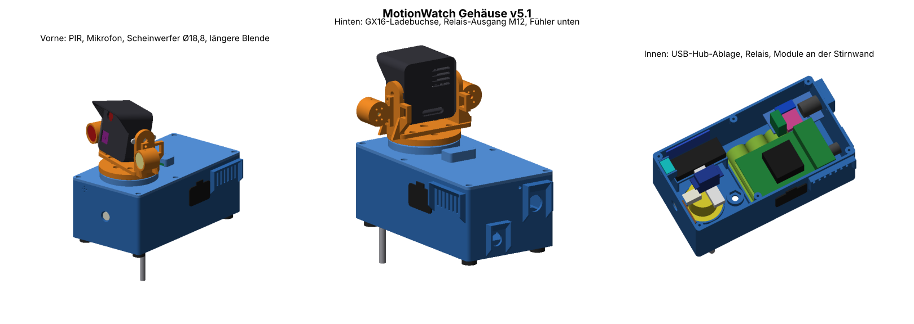

# MoveEye Gehäuse v5.1

Das 3D-Gehäuse für MoveEye (früher MotionWatch): Raspberry Pi 5 mit Schwenk-/Neigekopf (2 × MG90S), Camera Module 3 NoIR,
Thermal-90, UPS HAT (E) mit 4 × 21700, Lampen weiss + IR, Lautsprecher, PIR, Mikrofon. Stand 30.10.2026.

- **Unterteil:** 183 × 97 × 71,5 mm (mit Füssen 77,5 mm), **Gesamthöhe** ca. 161 mm, Kopf 58 × 58 mm
- **Drucker:** Bambu Lab X2D, PETG, alle Teile ohne Stützen
- **Grundstellung:** Der Kopf schaut zur Stirnseite mit PIR und Mikrofon («vorne»), die Ladebuchse ist hinten.



## Übersicht

| Was | Wo |
|---|---|
| Montage und Druck v5.1 | [Dokumente/LIESMICH_Montage_v5-1.md](Dokumente/LIESMICH_Montage_v5-1.md) |
| Kopf-Montage im Detail (v4.1) | [Dokumente/LIESMICH_Montage_v4-1_Kopf.md](Dokumente/LIESMICH_Montage_v4-1_Kopf.md) |
| Materialliste mit Bestellliste | [Dokumente/Materialliste.md](Dokumente/Materialliste.md) |
| Übergabe an die Software (Strom, Anschlüsse, Adressen) | [Dokumente/Uebergabe_Gehaeuse_v5.md](Dokumente/Uebergabe_Gehaeuse_v5.md) |
| Übergabe-Paket (Stand, offene Punkte, Entscheidungen) | [Dokumente/Uebergabe_Paket_v5-1.md](Dokumente/Uebergabe_Paket_v5-1.md) |
| Druckdateien (2 Platten, 3MF) | [Druckdateien/](Druckdateien/) |
| Parametrisches Modell (Python) | [Quellcode/](Quellcode/) |
| Teile, Materialliste, Montageschritte in 5 Sprachen (für MoveEye und Simulator) | [bau.json](bau.json) |
| Bilder | [Bilder/](Bilder/) |

## Druckdateien

- **Im Repository:** die zwei Platten für den X2D, fertig verteilt:
  - [Platte A: Unterteil, Zwischenboden, HDMI-Stopfen, 4 Füsse](Druckdateien/MotionWatch_v5-1_Platte_A_Unterteil.3mf)
  - [Platte B: Deckel, Drehteller, Gabel, Arm 2, Kopf, Seitendeckel, 2 Lampenhalter](Druckdateien/MotionWatch_v5-1_Platte_B_Deckel_Kopf.3mf)
- **Einzelne STL-Dateien (11 Teile, 55 MB, als ZIP 9 MB):** nicht im Repository, damit es klein bleibt. Sie liegen im
  Übergabe-Paket bzw. als `MoveEye_Gehaeuse_v5-1_STL.zip`; neu erzeugen mit `python3 werkzeuge/gehaeuse_bauen.py --druck`.

Vor dem Druck des Unterteils bitte die Masse des **UPS HAT (E) mit Akkus** nachmessen (angenommen 90 × 80 × 26 mm,
Parameter `BAT_L/BAT_W/BAT_H` und `PI_Z_ABOVE_FLOOR` oben in `Quellcode/v5.py`).

## Eine Quelle: neu bauen

`Quellcode/` ist Daniels parametrisches Modell (eigene SDF-CSG-Bibliothek `csg.py`, Netz mit Marching Cubes,
Vereinfachung `decimate.py`). Gebraucht werden `numpy`, `scipy`, `scikit-image`, `matplotlib`.

```
python3 werkzeuge/gehaeuse_bauen.py --sim      # Simulator-Modelle + Texte (ca. 3–5 min)
python3 werkzeuge/gehaeuse_bauen.py --texte    # nur Texte (nach Änderungen an bau.json)
python3 werkzeuge/gehaeuse_bauen.py --druck    # STL + 3MF neu (lange: Unterteil allein ca. 20–25 min)
python3 werkzeuge/gehaeuse_bauen.py --bilder   # Vorschaubilder neu (prev51.py)
python3 werkzeuge/gehaeuse_bauen.py --pruefen  # passen Simulator-Modelle und Daten zur Quelle?
```

Direkt im Ordner `Quellcode/` gehen weiterhin Daniels Befehle (`python3 v5.py`, `export5.py`, `plates5.py`,
`printcheck5.py`, `check5.py`, `prev51.py`, siehe Übergabe-Paket). Die grossen Zwischendateien `out51/*.npz` sind nicht im
Repository; `export5.py` erzeugt sie neu.

Was daraus entsteht:

| Ergebnis | Ort |
|---|---|
| vereinfachte Teile für den Simulator (alle Teile, ca. 58 000 Dreiecke) | `simulator3d/inhalte/gehaeuse/gehaeuse.glb` |
| äussere Teile, gröber, für «Lite» (ca. 8 000 Dreiecke) | `simulator3d/inhalte/gehaeuse/gehaeuse_lite.glb` |
| Gruppen (Unterteil / Pan / Tilt), Farben, Explosion, Prüfsumme der Quelle | `simulator3d/inhalte/gehaeuse/modelle.json` |
| Texte der Werkstatt (Teile, Materialliste, Montage) | `simulator3d/scripts/werkstatt_daten.gd`, Übersetzungen in `simulator3d/i18n/texte.json` |
| Daten für die MoveEye-Seite «Gehäuse & Bau» | `quelle/639q_daten_gehaeuse.py` |

Der Selbsttest von MoveEye (Teil 639r) prüft im Repository mit einer SHA-256-Prüfsumme über `Quellcode/*.py`, `bau.json`
und `werkzeuge/gehaeuse_bauen.py`, dass Simulator-Modelle und Texte zur Quelle passen.

## In MoveEye und im Simulator

- **MoveEye:** Mehr → **«Gehäuse & Bau»** (`/case`): Montage Schritt für Schritt, Materialliste, Links zu den Druckdateien,
  Knopf «Im Simulator ansehen» (öffnet die Werkstatt im Simulator, auch direkt bei einem Montageschritt).
- **Simulator:** Mehr → **«Werkstatt»**: Gehäuse drehen, zoomen, Explosion (Regler), durchsichtig, Innenleben,
  Teil anklicken (Name, Eintrag der Materialliste, Montageschritt), Montage als Abfolge mit Weiter / Zurück.
- **Am Gerät in der Szene** zeigt der Simulator die vereinfachten echten Teile (abschaltbar in der Werkstatt). Die Kameras
  und die Erkennung sitzen genau wie vorher.

## Variante v5.2 und älteres Material

- **v5.2** (Weitwinkel-Kamera in der Stirnwand, 5-mm-IR-LED, Status-LED auf dem Kopf, 2 Tasten hinten, Blindstopfen) ist
  in `docs/Gehaeuse_Variante2_Weitwinkel.md` beschrieben. Das Paket v5.2 ist hier **noch nicht** eingebaut; die Werkstatt
  zeigt diese Teile nur als Variante (Lage aus `v52.py`).
- **Archiv «PanTilt v6» (22.10.2026):** `PanTilt_v6_X2D_alle_Teile.3mf`, 7 Teile mit der alten Nummerierung
  (1_Gehaeuse_Unterteil … 7_Rueckdeckel), Unterteil 122 × 87 × 48 mm. Das ist die **ältere** PanTilt-Linie (v4, geschlossener
  Kopf mit Rückdeckel – der gescheiterte Druck), nicht neuer als v5.1. Nicht im Repository (6,8 MB), nur als Archiv abgelegt.

## Lizenz

Das Gehäuse (Modell, Quellcode in `Quellcode/`, Druckdateien, Anleitungen und Bilder) ist **Daniels eigenes Werk**
(DonElektro). Alle Rechte bei Daniel; eine offene Lizenz ist (noch) nicht vergeben. Die Werkzeuge im Repository
(`werkzeuge/gehaeuse_bauen.py`) gehören zum Projekt MoveEye.
